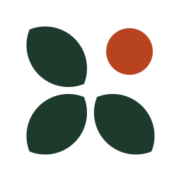

<p>
  
</p>

# Alan Joshua

Personal portfolio of Alan Joshua, who builds and evaluates AI systems. It covers his work at Nunnari Labs, his freelance ERP and CRM systems, and the models he publishes as [CloveAI](https://huggingface.co/CloveAI), led by [clov-embed-v2](https://huggingface.co/CloveAI/clov-embed-v2).

The site is laid out like a herbarium. Each piece of work gets a typed specimen label and a 3D plate, an ink-dot point cloud that morphs to show what it does. Each dataset is drawn with one dot per row.

## Run it

```bash
npm install
npm run dev
```

Open http://localhost:3000. Use `npm run build` for a production build and `npm run lint` to lint.

## Where things live

| Path | What it holds |
| --- | --- |
| `lib/catalog.ts` | Every fact on the page: experience, projects, skills, education, models and datasets. Edit this first |
| `lib/specimens.ts` | The point cloud for each 3D plate |
| `lib/spam-labels.ts` | Real labels for `india-spam-sms`, one bit per row |
| `components/site/` | The page sections |
| `components/ui/` | shadcn/ui components |
| `components/base/` | BoardUI components |
| `public/brand/` | Logo files: the AJ mark, its heavier small cut, lockups and icons |
| `public/hairline/` | The plant press in Skills: the unchanged Hairline engine (`kernel.js`), the figure (`press.js`) and a standalone page (`press.html`) |

## Stack

- Next.js 16, React 19, Tailwind CSS 4
- Three.js with React Three Fiber for the plates
- GSAP ScrollTrigger for the experience plates and the hero scatter
- Framer Motion for section entrances and the plate rail
- Anime.js for the logo draw-on, number counters and dataset plates
- shadcn/ui for buttons, tabs, the project accordion, the mobile menu and tooltips
- BoardUI for the sortable model index
- The engine of [`@lucasmarkes/hairline`](https://lucasmarkes.com/lab/hairline) for the plant press

Dataset rows are read live from the Hugging Face datasets server when a visitor points at a dot.
