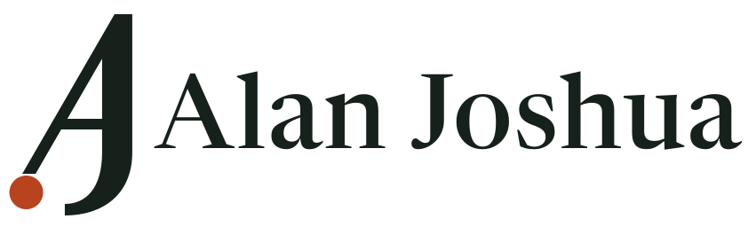

<p>
  
</p>

Portfolio site for [CloveAI](https://huggingface.co/CloveAI), built around [clov-embed-v2](https://huggingface.co/CloveAI/clov-embed-v2), a sentence embedding model Alan Joshua trained from scratch.

The site is laid out like a herbarium. The other models each get a typed specimen label and a 3D plate, an ink-dot point cloud that morphs to show what the model does. Each dataset is drawn with one dot per row.

## Run it

```bash
npm install
npm run dev
```

Open http://localhost:3000. Use `npm run build` for a production build and `npm run lint` to lint.

## Where things live

| Path | What it holds |
| --- | --- |
| `lib/catalog.ts` | Every model and dataset fact on the page. Edit this when something is published |
| `lib/specimens.ts` | The point cloud for each 3D plate |
| `lib/spam-labels.ts` | Real labels for `india-spam-sms`, one bit per row |
| `components/site/` | The page sections |
| `components/ui/` | shadcn/ui components |
| `components/base/` | BoardUI components |
| `public/brand/` | Logo files |

## Stack

- Next.js 16, React 19, Tailwind CSS 4
- Three.js with React Three Fiber for the plates
- GSAP ScrollTrigger for scroll-driven specimen changes and the hero scatter
- Framer Motion for section entrances and the plate rail
- Anime.js for the logo draw-on, number counters and dataset plates
- shadcn/ui for buttons, tabs, the mobile menu and tooltips
- BoardUI for the sortable model index

Dataset rows are read live from the Hugging Face datasets server when a visitor points at a dot.
